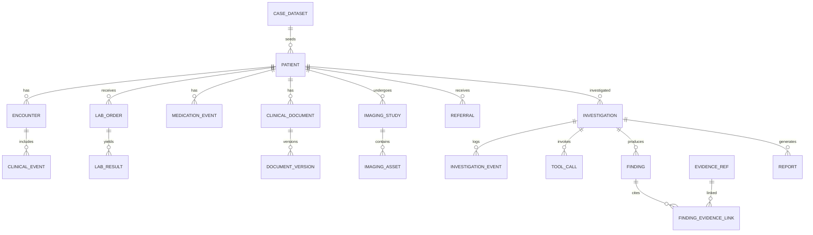

# CASETRACE — SQLite Database Schema

Refactor 05 stores its bounded task graph, leads, candidate creator references and
strategy in existing context JSON and ordered events; no migration is required.
Repeated specialist executions allocate per-role attempts inside the shared writer
lock, preserving run/role/attempt uniqueness. REST summarizes each role once; full
execution history stays in rows/events. Task/agent/tool IDs correlate audit lineage;
a dedicated evidence-to-tool foreign key remains future migration work.

Phase 3 migration `0004_investigation` implements investigation persistence using
the catalog table names. Exact typed anchors are JSON in evidence_refs; finding
body includes deterministic verification checks, support category and alternatives.
The source identity/version/hash/encounter/field remains in each anchor rather than
duplicated scalar columns. Reports retain typed body_json and unique run/version.
Stages/agents have unique run/key/attempt; tool_calls persist failure metadata and
source refs. No separate hypothesis or timeline tables: these are projections in
the run context and final report. Run status CHECK uses public contract values,
including completed_with_limitations. Application services enforce subordinate
status transitions; the MVP does not implement leases or terminal-run resumption.

**Document:** `docs/database-schema.md`
**Status:** Proposed canonical logical schema; confirm existing IDs/API DTOs before migration  
**Version:** 1.1 · **Stack:** SQLite, SQLAlchemy 2.x, Alembic, FastAPI

## 1. Purpose

Define durable storage for CASETRACE's **synthetic hospital source records** and **derived investigations**, while keeping evaluator-only hidden ground truth outside runtime access. Optimize for CASE-001 first, then CASE-002–CASE-010 without redesign.

## 2. Architecture principles

- **Three trust zones:** (A) immutable simulated hospital records, (B) derived agent investigation outputs, (C) offline evaluation answer key. Zone C must be physically unavailable to the hospital and investigation runtime process.
- The API's public `patient_id`/`encounter_id` is an opaque, stable string; internal DB primary keys may be UUIDs. A fixed mapping must be decided in ADR before seeding (`PAT-001` vs `SYN-001` must not be guessed).
- Every clinical record has stable resource ID, patient, source lineage, timestamps with original timezone/precision where needed, and an optional document/encounter relationship.
- Preserve original records/versions. Corrections create new version or append-only amendments; never silently overwrite content used in evidence.
- Store document and image blobs in controlled asset storage, SQLite metadata references in DB, and SHA-256 hashes for integrity.
- Use a shared UTC-normalizing SQLAlchemy type adapter for known instants, restoring timezone-aware UTC on load; retain original literal/offset/timezone and precision fields for ambiguous/date-only clinical source times. SQLite does not preserve offsets through `DateTime(timezone=True)` alone.
- Patient-scoped access checks must be enforced by services/repositories; SQLite has no row-level security or per-table grants; use explicit service checks and OS/container file permissions.
- Pseudorandom synthetic fixtures use deterministic external IDs and idempotent seed scripts. Never use copied real patient data.

## 3. Namespaces, conventions and ID policy

Read [development stack and SQLite operations](development-stack.md) for portable UUID/JSON/enum/UTC types, settings and absolute path resolution, connection PRAGMAs, session lifecycle, migrations, backups and isolated tests. These are mandatory implementation requirements. Public IDs, status values and evidence contracts are unchanged by the stack migration.

Use logical `hospital` and `investigation` modules/repositories in one SQLite database, without database schema qualifiers; keep evaluation answer keys in **separate offline database/files not mounted to application containers**. Naming below omits schema qualifiers for readability. Example external IDs are conceptual and must be adapted to `case-schema.md` and `frontend-backend-contract.md`.

**Columns common to source records:** `id Uuid PK`, `external_id TEXT UNIQUE` (scoped by dataset/tenant if necessary), `patient_id Uuid FK`, `encounter_id Uuid FK NULL`, `source_version INTEGER`, `source_system TEXT`, `created_at UTC datetime`, `updated_at UTC datetime`; clinical times are resource-specific. Raw input payload SQLAlchemy `JSON` optional, not a substitute for typed searchable columns.

## 4. Entity relationships



## 5. Table catalog: hospital zone

| Table | Required columns beyond common identifiers | Relationships / rules |
|---|---|---|
| `case_datasets` | `case_id`, `dataset_version`, `seed_hash`, `status`, `seeded_at` | Unique `(case_id, dataset_version)`; no answer key fields |
| `patients` | `dataset_id`, `external_id`, `synthetic_mrn`, `display_name`, `birth_date`, `sex`, `is_synthetic` | `dataset_id` FK; unique MRN per dataset; `is_synthetic=true` |
| `encounters` | `patient_id`, `external_id`, `type`, `status`, `started_at`, `ended_at`, `facility_label` | FK patient; date check where exact instants available |
| `clinical_events` | `patient_id`, `encounter_id?`, `external_id`, `event_type`, `event_time`, `time_precision`, `time_raw`, `documented_at`, `source_ref_id?`, `payload` | Event vs documentation distinct; append-only evidence |
| `lab_orders` | `patient_id`, `encounter_id?`, `external_id`, `ordered_at`, `status`, `panel_code?` | FK patient, encounter; order ≠ completed test |
| `lab_results` | `lab_order_id`, `patient_id`, `external_id`, `analyte_code`, `value_numeric?`, `value_text?`, `unit?`, `reference_low?`, `reference_high?`, `collected_at?`, `reported_at?`, `status`, `supersedes_id?` | FK order; original/corrected lineage, no silent overwrite |
| `medication_events` | `patient_id`, `encounter_id?`, `external_id`, `record_type`, `drug_name`, `dose?`, `unit?`, `route?`, `frequency?`, `ordered_at?`, `effective_at?`, `administered_at?`, `discontinued_at?`, `status`, `parent_event_id?` | Order/admin/dispense/reconciliation explicitly different |
| `clinical_documents` | `patient_id`, `encounter_id?`, `external_id`, `document_type`, `author_label`, `status`, `event_at?`, `authored_at?`, `signed_at?`, `current_version_id?` | Logical document identity; pointers to immutable versions |
| `document_versions` | `document_id`, `version_number`, `artifact_id?`, `text_content?`, `content_hash`, `amended_at?`, `supersedes_version_id?` | Unique `(document_id, version_number)`; preserve old versions |
| `assets` | `external_id`, `storage_key`, `mime_type`, `sha256`, `byte_size`, `synthetic_label`, `created_at` | Controlled storage key, no raw path traversal; synthetic label |
| `imaging_studies` | `patient_id`, `encounter_id?`, `external_id`, `modality`, `body_region`, `ordered_at?`, `performed_at?`, `reported_at?`, `report_document_id?`, `status` | Report relationship optional; no assumed imaging diagnosis |
| `imaging_assets` | `study_id`, `asset_id`, `external_id`, `series_label?`, `asset_kind`, `ordinal?` | Unique asset linkage; identify synthetic illustration |
| `referrals` | `patient_id`, `encounter_id?`, `external_id`, `origin_service`, `destination_service`, `requested_at`, `scheduled_at?`, `completed_at?`, `status`, `document_id?` | Request ≠ appointment ≠ completed follow-up |

**Referential constraint:** Records must not reference an encounter belonging to a different patient. Enforce via composite keys/constraints where practical or repository transaction validation with DB trigger/check. The same applies to study/report, lab order/result and source document links.

## 6. Table catalog: investigation zone

| Table | Key fields | Constraints / purpose |
|---|---|---|
| `investigations` | `id`, `external_id`, `patient_id`, `dataset_id`, `status`, `question`, `requested_by`, `idempotency_key?`, `created_at`, `started_at?`, `ended_at?`, `retry_of_id?`, `version` | Single patient/run; lifecycle CAS updates |
| `investigation_stages` | `id`, `investigation_id`, `stage_key`, `attempt`, `status`, `started_at?`, `ended_at?`, `error_code?` | Unique `(investigation_id, stage_key, attempt)` |
| `agent_executions` | `id`, `investigation_id`, `stage_id?`, `agent_key`, `attempt`, `status`, `started_at?`, `ended_at?`, `task_summary?` | No stored hidden chain-of-thought |
| `tool_calls` | `id`, `investigation_id`, `agent_execution_id?`, `tool_name`, `attempt`, `status`, `sanitized_args`, `result_refs`, `requested_at`, `started_at?`, `completed_at?`, `error_code?`, `duration_ms?` | Actual calls only; preserve failures |
| `investigation_events` | `id`, `investigation_id`, `sequence`, `event_type`, `payload`, `occurred_at`, `tool_call_id?`, `agent_execution_id?` | Unique `(investigation_id, sequence)`; durable SSE replay |
| `evidence_refs` | `id`, `investigation_id`, `patient_id`, `source_type`, `source_external_id`, `source_version?`, `source_artifact_id?`, `anchor_kind`, `anchor`, `excerpt?`, `retrieved_at`, `tool_call_id?`, `source_hash?` | Only resolved hospital records; exact anchors |
| `findings` | `id`, `investigation_id`, `version`, `finding_type`, `claim_text`, `status`, `support_level?`, `alternatives`, `limitations`, `created_at` | Candidate/verified/refuted/inconclusive; never ground-truth label |
| `finding_evidence_links` | `finding_id`, `evidence_ref_id`, `relationship`, `validation_status`, `reason?` | Composite PK `(finding_id,evidence_ref_id,relationship)`; supports/refutes/context |
| `reports` | `id`, `investigation_id`, `version`, `status`, `body_json`, `generated_at?`, `supersedes_report_id?` | Versioned outputs; only validated material citations |
| `run_leases` (optional) | `investigation_id`, `worker_id`, `lease_expires_at`, `heartbeat_at` | Avoid concurrent run workers; claim with a version/status-guarded update; no row locks |

## 7. Minimal SQLite DDL reference

This is an **illustrative migration skeleton**, not a full schema dump. Build canonical Alembic migrations for every table and adjust external-ID namespaces after contract audit.

```sql
-- Illustrative only: application supplies UUID hex IDs and normalized UTC times.
-- Configure connections and file WAL through the shared factory, not this DDL.

CREATE TABLE case_datasets (
  id CHAR(32) PRIMARY KEY NOT NULL,
  case_id TEXT NOT NULL,
  dataset_version TEXT NOT NULL,
  seed_hash TEXT NOT NULL,
  status TEXT NOT NULL DEFAULT 'ready',
  seeded_at DATETIME NOT NULL,
  UNIQUE (case_id, dataset_version)
);

CREATE TABLE patients (
  id CHAR(32) PRIMARY KEY NOT NULL,
  dataset_id CHAR(32) NOT NULL REFERENCES case_datasets(id),
  external_id TEXT NOT NULL,
  synthetic_mrn TEXT NOT NULL,
  display_name TEXT NOT NULL,
  birth_date DATE,
  sex TEXT,
  is_synthetic BOOLEAN NOT NULL DEFAULT true CHECK (is_synthetic = true),
  UNIQUE (dataset_id, external_id),
  UNIQUE (dataset_id, synthetic_mrn)
);

CREATE TABLE encounters (
  id CHAR(32) PRIMARY KEY NOT NULL,
  patient_id CHAR(32) NOT NULL REFERENCES patients(id),
  external_id TEXT NOT NULL,
  type TEXT NOT NULL,
  status TEXT NOT NULL,
  started_at DATETIME,
  ended_at DATETIME,
  UNIQUE (patient_id, external_id),
  CHECK (ended_at IS NULL OR started_at IS NULL OR ended_at >= started_at)
);

CREATE TABLE investigations (
  id CHAR(32) PRIMARY KEY NOT NULL,
  external_id TEXT NOT NULL UNIQUE,
  patient_id CHAR(32) NOT NULL REFERENCES patients(id),
  dataset_id CHAR(32) NOT NULL REFERENCES case_datasets(id),
  status TEXT NOT NULL DEFAULT 'queued'
      CHECK (status IN ('queued','running','completed','partial','failed','cancelled')),
  question TEXT NOT NULL,
  requested_by TEXT,
  idempotency_key TEXT UNIQUE,
  retry_of_id CHAR(32) REFERENCES investigations(id),
  version INTEGER NOT NULL DEFAULT 1,
  created_at DATETIME NOT NULL,
  started_at DATETIME,
  ended_at DATETIME
);

CREATE TABLE investigation_events (
  id CHAR(32) PRIMARY KEY NOT NULL,
  investigation_id CHAR(32) NOT NULL REFERENCES investigations(id),
  sequence BIGINT NOT NULL,
  event_type TEXT NOT NULL,
  payload JSON NOT NULL DEFAULT '{}',
  occurred_at DATETIME NOT NULL,
  UNIQUE (investigation_id, sequence)
);

CREATE INDEX idx_events_resume ON investigation_events(investigation_id, sequence);
CREATE INDEX idx_encounter_timeline ON encounters(patient_id, started_at, id);
CREATE INDEX idx_investigation_patient ON investigations(patient_id, created_at DESC);
```

**Critical note:** The skeleton preserves existing illustrative status values; it does not resolve the documented enum conflict. SQLAlchemy models supply UUID and UTC defaults. Schema above is partial by design; the catalog tables still require full migrations. Do not use `create_all()` as a replacement for Alembic in persistent demo environments. Add tenant scope to uniqueness constraints once the tenant model is finalized.

## 8. Temporal model

Use resource-appropriate time fields, not one overloaded `timestamp`. Lab collected and reported times, medication ordered/administered/held times, note event/authored/signed times and image performed/reported times are semantically different.

For source date-only/uncertain time preserve `time_raw`, `time_precision` (`instant`, `minute`, `date`, `unknown`), and source timezone when known. A retrospectively documented event is not automatically contradictory. Comparing two uncertain times may produce `indeterminate`, not Boolean `true/false`.

## 9. Evidence link resolution

`evidence_refs` store `source_type` + `source_external_id` + version + anchor (e.g. JSON path, document page/span, image region). Their target resolution requires a service lookup restricted to the investigation patient, dataset, and authorized actor. A generic polymorphic reference cannot have a traditional SQL FK to all source tables; therefore implement a **validated resolver** plus integrity checks on creation and report publication. Do not assume an opaque source ID proves the cited content exists.

Document evidence should reference immutable document version and checksum; changes/supersession must never silently rebind the citation. Store relationship role and validation status in `finding_evidence_links`.

## 10. Transactions, indexing, consistency

- Case seed: single logical import with preflight validation; insert dependency order and transactional rollback on failed references. Idempotent on `(case_id, dataset_version, external_id)`.
- Run claim: guarded `UPDATE ... WHERE status='queued' AND version=:expected_version` with affected-row validation and version increment, or a similarly guarded lease. Append event and state change atomically; use transactional outbox when stream delivery is external.
- Report publish: transactionally verify required citations, insert report version, and set investigation terminal status only if report is ready.
- Index clinical tables on `(patient_id, event_time)` or equivalent; `(encounter_id)` for joins; document versions `(document_id, version_number)`; lab `(patient_id, collected_at, analyte_code)`; medication `(patient_id, effective_at)`; tool calls `(investigation_id, started_at)`; findings `(investigation_id,status)`.
- Avoid copying entire documents into audit payloads or SSE events; hold access-controlled metadata and stable source references.

## 11. Security and isolation

- SQLite has no server credentials or table roles. Keep migration/import writes in maintenance tooling; runtime clinical repositories expose reads only, investigation repositories expose controlled writes, and OS/container permissions restrict the database file.
- Keep evaluator answers in separate files/database outside runtime mounts and context. Test that runtime processes cannot read them; SQLite table naming is not an access boundary.
- Scope all resource queries to patient and dataset; add tenant/facility authorization for multi-tenant support. Check every citation deep link server-side.
- Avoid raw filesystem paths in API. Serve assets via secure IDs and MIME allowlisting.
- Never log full medical records, API keys, signed URLs or sensitive runtime environment variables. Synthetic data is still treated as controlled demo content.

## 12. Migration and fixture strategy

1. Initial Alembic revision for hospital source tables and constraints.
2. Separate revision for investigation/event/evidence/report tables.
3. Use Pydantic importer to validate `case-schema.md` and synthetic artifacts; fail on duplicates/broken references.
4. Freeze `CASE-001` fixture version and hash. Seed the same dataset across developer machines and CI.
5. Separate hidden answer key outside the API runtime and enforce isolation in CI.
6. Reset only investigation-derived rows for selected demo tenant/run; preserve immutable hospital sources and archive audit logs per policy.
7. Add case expansions after the golden vertical slice is passing.

## 13. Tests

**Schema:** unique IDs, FK deletion policies, check constraints, amendment/version uniqueness, migrations up/down where supported.  
**Clinical correctness:** encounters cannot cross patients; result order scope valid; medication order vs administration distinct; note versions preserved; ambiguous timestamps remain ambiguous.  
**Investigation:** state transition concurrency, idempotent creation, ordered SSE events, tool errors, immutable source data, verified citations before report publication.  
**Security:** other-patient record denied, hidden ground-truth namespace inaccessible, asset path traversal blocked, records not leaked through event logs.  
**Operations:** idempotent CASE-001 seed, deterministic reset, checksums and storage asset availability.

## 14. Contract audit before coding

The repository has previously used differing illustrative patient IDs (`PAT-001`, `SYN-001`) and API routes. Choose the exact external ID and mapping once, then align `case-schema.md`, `hospital-api.md`, `frontend-backend-contract.md`, database constraints, generated client types, and test fixtures. Likewise finalize state enum names and event envelope from `investigation-state-machine.md` and citation anchor schema from the evidence contract. Record changes in an ADR.

## 15. Definition of done

A clean file-backed SQLite database can be migrated, seeded with frozen CASE-001 artifacts, queried using hospital service methods, and used for a genuine investigation run. Every source and derived record has stable provenance, citations resolve to exact authorized sources, migrations and tests pass, and evaluation answer keys are unreachable by runtime processes.

## Phase 2 implemented hospital mappings

[Contract decisions](CONTRACT_DECISIONS.md) fixes public IDs and DTO mappings.
`0002_hospital` adds the hospital catalog and `0003_clinical_reports` adds:

| Table | Fields and relationships |
| --- | --- |
| `diagnoses` | Common scoped source columns; name, code_system, code, status, diagnosed_at |
| `symptoms` | Common scoped source columns; name, onset_at, severity, frequency, status, description |
| `diagnostic_reports` | Common scoped source columns; report_type, title, status, issued_at, conclusion, document_id FK, imaging_study_id FK |
| `report_observations` | Composite PK of report_id FK and observation_id FK |

The existing API/case field names map to storage explicitly: patient
`synthetic_identifier/date_of_birth` → `synthetic_mrn/birth_date`; encounter
`encounter_type` → `type`; observation `test_code/specimen_collected_at` →
`analyte_code/collected_at`; medication `medication_name/dose_unit/start_at` →
`drug_name/unit/effective_at` (the last only for exact instants). Document text
lives in `document_versions`; storage metadata lives in `assets`. Referral
`ordered_at/appointment_at` → `requested_at/scheduled_at`. Source payloads retain
original validated clinical fields and precision, never evaluator sections.

The canonical observation has no lab order ID, so `lab_order_id` is nullable.
Encounter department/provider and document title/MIME remain separate typed
columns; do not substitute facility names. Diagnosis/symptom date-only values
retain their source literal with a null normalized instant. Imported medications
represent documented history, never assumed administration. Source-version and
created/updated metadata derive from the case version/timestamps.

All importer cross-references (including report/observation/study) are validated
inside the one-patient case before the import transaction. Encounter and source
 document patient links additionally use composite DB foreign keys. Runtime
repositories expose reads only; imports require maintenance access. Applied
source updates/amendments remain a separate future workflow; changed imports
fail closed rather than rewriting old document versions or citations.
