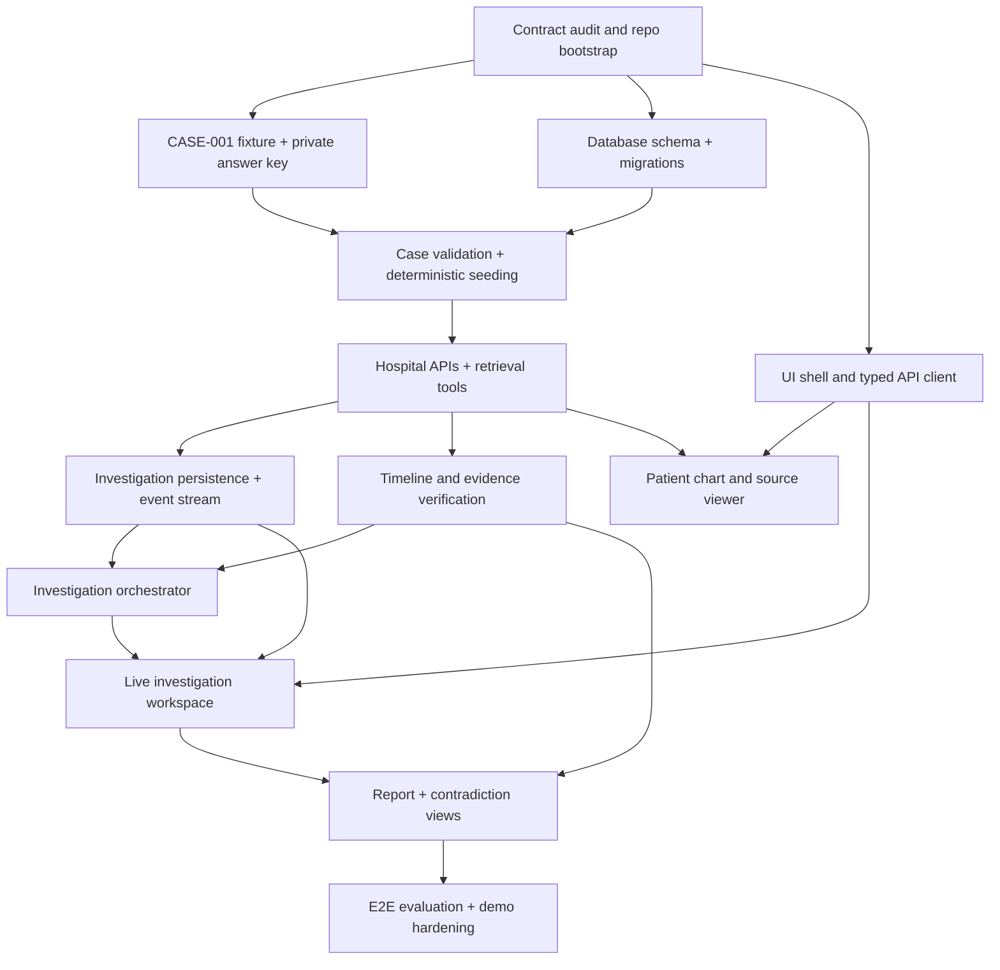

# CASETRACE — Implementation Plan

**Document:** `docs/implementation-plan.md`
**Status:** Implementation baseline / revise against repository contracts  
**Version:** 1.0  
**Primary release:** CASE-001 evidence-backed vertical slice  
**Audience:** Development team, coding agents, technical reviewers, demo operators

---

## 1. Purpose

This document converts CASETRACE's product concept, specifications, and agent skills into an ordered implementation program. It specifies what to build, in what sequence, how components integrate, and what evidence proves completion.

CASETRACE is an **investigation-support prototype** operating over a **synthetic hospital information system**. It retrieves longitudinal clinical records through audited tools, reconstructs timelines, tests possible contradictions, and generates a report with verifiable citations. It is not a real clinical decision-support deployment and must not be presented as diagnosing or treating patients.

**North-star milestone:** From a seeded CASE-001 patient record, a user launches an investigation. The backend runs actual hospital retrieval tools, identifies and verifies the case's intended timeline contradiction, and returns a report with citations that open the original records and relevant fragments.

## 2. Implementation principles

1. **One vertical slice before horizontal expansion.** Complete CASE-001 end-to-end before generating CASE-002 through CASE-010 or polishing every hospital screen.
2. **Source records are immutable evidence.** Keep original synthetic notes, labs, medication records, images, and documents separate from derived agent findings.
3. **No answer-key leakage.** Hidden synthetic-case ground truth is used only for generation, offline evaluation, and tests; the investigation runtime cannot access it.
4. **Real tools, real events.** Agent tool use passes through approved clinical service interfaces. The UI shows backend-persisted events, not fabricated progress.
5. **Contract first.** Do not silently change API paths, IDs, event schemas, or investigation status enums. Resolve discrepancies explicitly and update dependent tests/docs.
6. **Evidence before explanation.** A finding remains a candidate until the corresponding source references are resolved and checked. Preserve counterevidence and uncertainty.
7. **Determinism by design.** Dataset versions, stable identifiers, fixed test fixtures, reproducible orchestration stubs, and demo reset routines are mandatory.
8. **Small coding-agent tasks.** Implement modules in bounded changes, run their tests, integrate, and then start the next dependent task.

## 3. Sources of truth and precedence

Before editing, the implementing agent must inspect the actual filenames and contents of the repository. Expected documents include:

| Source | Owns |
|---|---|
| `AGENTS.md` | Repository-specific coding-agent instructions |
| `docs/backend-architecture.md` | Backend layer boundaries, services, execution architecture |
| `docs/frontend-architecture.md` | Next.js structure, client/server boundaries, UI integration |
| `docs/frontend-backend-contract.md` | Browser-facing API paths, DTOs, and events |
| `docs/case-schema.md` | Synthetic case structures and relationships |
| `docs/agent-tools.md` | Tool names, parameters, output and permissions |
| `docs/hospital-api.md` | Simulated hospital retrieval behavior |
| `ui-design/` | Approved interface and visual design direction |
| `.skill/` | Task-specific coding-agent procedures and guardrails |

**Priority rule:** The user's current task and explicit contracts override examples in skill files. If contracts conflict with one another, stop that *specific interface implementation* long enough to record and resolve the conflict; continue unrelated tasks. Do not guess an ID mapping or quietly implement two incompatible payloads.

### 3.1 Mandatory contract audit (before feature work)

Resolve the following with a short decision record, a canonical example fixture, and contract tests:

- Patient identifier (`PAT-001` vs `SYN-001` or any existing alternative), synthetic MRN, `case_id`, and resource ID namespaces.
- API route prefixing and response envelope conventions.
- Exact status enums for investigations, agents, tools, findings, and documents.
- SSE event schema: event ID, sequence/cursor, type, `investigation_id`, timestamps, payload, reconnect behavior.
- Time definitions: clinical occurrence, collection, report, authored, recorded, amended and retrieved times.
- Evidence reference schema: source type, resource ID, version, page/span/field anchor, patient scope, and validation result.
- Distinction among hospital data, agent-derived conclusions, and evaluator-only answer keys.

**Exit condition:** A single fixture can pass through the case loader, API, tool adapter, and frontend type definitions without lossy or conflicting remapping.

## 4. Release scope

### 4.1 MVP / must-have

- CASE-001 fully populated with validated synthetic records and at least two independent sources supporting the targeted investigation.
- SQLite schema and repeatable seed for patient, encounters, labs, medications, notes, documents, imaging metadata, and investigation state as required by the case.
- FastAPI hospital endpoints and agent-facing retrieval tools for CASE-001's actual evidence types.
- Investigation creation, run persistence, real tool execution, timeline construction, conflict detection, source verification, and report retrieval.
- Next.js patient chart, investigation workspace, agent activity, timeline, evidence inspector, contradiction comparison, report view.
- Evidence links resolve to original source resources; inaccessible or missing citations fail visibly.
- Tests covering end-to-end success, at least one no-contradiction control, tool failure, and wrong-patient scope.
- Demo preflight and idempotent reset.

### 4.2 Nice-to-have after MVP

- More case varieties and all CASE-002–CASE-010.
- Additional specialist agents and richer hypothesis comparison.
- High-fidelity synthetic image viewing and interactive imaging annotations.
- Advanced document extraction/OCR and semantic cross-record search.
- Multi-tenant permissions beyond the minimum prototype safety boundary.
- Sophisticated analytics, performance optimizations, enterprise integrations, and real EHR/FHIR interoperability.

### 4.3 Explicitly out of scope

- Real patient data; live hospital integration; real clinical deployments.
- Clinical diagnosis, treatment recommendations, autonomous prescribing, or validated risk prediction.
- Claiming synthetic illustrations are diagnostic-quality medical scans.
- Numeric medical confidence probabilities without a calibration/evaluation basis.

## 5. Proposed repository layout

Align this tree with the repository's existing structure; do not move working files merely for cosmetic conformity.

```text
CASETRACE/
├── AGENTS.md                           # or existing AGENT.md
├── README.md
├── .env.example
├── .gitignore
├── docker-compose.yml
├── apps/
│   ├── api/                            # FastAPI app, models, migrations, tests
│   └── web/                            # Next.js, TypeScript, routes, components
├── docs/
│   ├── implementation-plan.md
│   ├── frontend-architecture.md
│   ├── backend-architecture.md
│   ├── frontend-backend-contract.md
│   ├── case-schema.md
│   ├── hospital-api.md
│   ├── agent-tools.md
│   └── ...
├── ui-design/                          # HTML design references
├── .skill/                             # agent operating instructions
├── data/
│   └── cases/
│       └── CASE-001/
│           ├── manifest.json
│           ├── records/              # canonical synthetic public records
│           ├── assets/               # documents, synthetic illustrative images
│           └── ...
├── evaluation/                         # private evaluator-only keys, ACL restricted
├── scripts/                            # seed, validate, preflight, reset
└── tests/                              # cross-package/integration tests
```

**Security requirement:** `evaluation/` must not be copied into runtime image layers, exposed as static assets, bundled into Next.js, or mounted into the agent execution environment. In tests, use an isolated evaluator process or fixture directory.

## 6. Dependency map



**Critical path:** Contracts → CASE-001 + database → retrieval tools → evidence verification → investigation → report → rehearsed demo.

Some frontend layout work can proceed alongside backend tasks once types and example responses are locked. Do not connect fake final findings while backend implementation remains incomplete.

## 7. Phase 1 — Project foundation

**Goal:** Start implementation with compatible boundaries, repeatable local development, and testable interfaces.

Read [development stack](development-stack.md) for planned toolchain versions, uv environment management, pnpm scripts, lockfile/CI installation, SQLite connection lifecycle and isolated test foundations. Existing task IDs P0 through P6 and gate IDs G0 through G6 are retained for traceability; phase headings group them into the five finalized delivery phases without changing dependencies. P0-02 remains the contract audit prerequisite to affected interface implementation.

| ID | Task | Deliverable | Acceptance |
|---|---|---|---|
| P0-01 | Inventory repo, architecture docs, skills, and HTML prototypes | `docs/IMPLEMENTATION_INVENTORY.md` or a section in a work log | Every referenced component/file is located or marked missing |
| P0-02 | Run contract conflict audit | `docs/CONTRACT_DECISIONS.md` / ADRs | IDs, resource mappings, status enums and SSE envelope agreed |
| P0-03 | Define dev configuration and secrets policy | `.env.example`, `.gitignore`, README instructions | No secrets committed; commands documented |
| P0-04 | Bootstrap Next.js App Router + pnpm, FastAPI + uv, SQLite + aiosqlite + SQLAlchemy + Alembic | Manifests, committed lockfiles, central settings and initial migrations | Both apps start; root/API commands resolve the same DB; WAL/FK/busy timeout and shutdown verified |
| P0-05 | Establish format/type/test commands | package scripts, Python tooling, CI draft | Basic lint, type-check and smoke test pass |

**Exit gate G0:** A fresh checkout can run the empty application stack with a known configuration, and a contract example can be serialized and validated consistently.

## 8. Phase 2a — Hospital data foundation: freeze CASE-001

**Goal:** Build an actual testable longitudinal mystery, not a disconnected set of screenshots and sample JSON.

| ID | Task | Deliverable | Acceptance |
|---|---|---|---|
| P1-01 | Lock clinical timeline and decisive discrepancy | Private canonical chronology and answer key | The exact conflicting claims, dates and source IDs are unambiguous |
| P1-02 | Build canonical structured case data | Patient, encounters, events, labs, medications, notes, referrals, imaging metadata as required | IDs unique and all referenced relationships resolve |
| P1-03 | Generate clinical source documents | Searchable PDFs / note text / scanned-style assets | Metadata, visible synthetic labels and source IDs match structured data |
| P1-04 | Generate optional illustrative imaging | Approved synthetic image assets | Clearly marked synthetic; report linkage works; no false diagnostic claims |
| P1-05 | Implement schema and temporal validators | Repeatable validation script and report | Invalid references, impossible non-intentional timestamps and missing files fail |
| P1-06 | Freeze case manifest/version | Manifest with dataset checksum/version | Running generation/seed twice yields equivalent canonical records |
| P1-07 | Add negative control fixture | Small case without planted contradiction | Investigation should not fabricate a contradictory finding |

**CASE-001 case design rules:**

- The key finding requires connecting at least two tool-retrievable independent records; ideally a third confirms interpretation or excludes a plausible alternative.
- Preserve distinctions between notes reporting an event, objective results, and later retrospective charting.
- Deliberate inconsistency is documented in evaluator-only metadata; accidental contradictions are removed or explicitly marked as noisy/ambiguous.
- No runtime note title, chart banner, filename or public manifest field directly reveals the answer.

**Exit gate G1:** Case validation passes, all artifacts open, key source records exist independently, and an evaluator can test the expected outcome without exposing it to agents.

## 9. Phase 2b — Hospital data foundation: database and simulated hospital

**Goal:** Make CASE-001 retrievable through a realistic, typed, audited hospital system.

| ID | Task | Deliverable | Acceptance |
|---|---|---|---|
| P2-01 | Implement relational models and migrations | SQLite schema + Alembic history | Foreign keys, nullability, uniqueness and timestamps tested |
| P2-02 | Build idempotent case loader | `scripts/seed_case.py` or equivalent | Re-running does not duplicate records; source IDs remain stable |
| P2-03 | Implement repository/service layer | Typed hospital queries | Scoped patient/encounter/resource lookup and deterministic sorting |
| P2-04 | Implement required hospital API routes | Patient/encounter/lab/medication/document/imaging endpoints | Paths and payloads match authoritative contract |
| P2-05 | Implement file/asset access | Controlled document and imaging viewing | Invalid paths rejected; valid synthetic assets retrievable |
| P2-06 | Implement agent-facing hospital tools | Tool adapters from `agent-tools.md` | Calls go through approved services; tool outcomes have source refs |
| P2-07 | Add tool audit records | Persisted call metadata | Run ID, tool, outcome, duration and source IDs queryable |

**Minimum retrieval proof:**

1. Search for CASE-001 patient.
2. List its encounters.
3. Retrieve the two primary contradictory records through separate source tools.
4. Retrieve any corroborating laboratory/medication/document evidence.
5. Open the original source document or structured record and identify its timestamp semantics.

**Exit gate G2:** The planned mystery is recoverable using only documented hospital tools. A direct answer-key path is inaccessible, and a wrong-patient request cannot return CASE-001 evidence.

## 10. Phase 3a — Investigation engine: evidence and timeline

**Goal:** Normalize retrieved information into traceable, testable investigative evidence without modifying source facts.

| ID | Task | Deliverable | Acceptance |
|---|---|---|---|
| P3-01 | Implement evidence-reference model | Canonical source/version/field/page anchor type | Links resolve to exact authorized source |
| P3-02 | Implement provenance capture | Source metadata + tool-call lineage | Every extracted item records origin and retrieval context |
| P3-03 | Implement timeline builder | Ordered clinical events with time basis | Distinguishes event, collected, reported, recorded, amended times |
| P3-04 | Implement candidate contradiction detection | Comparison rules and candidate findings | Detects intended discrepancy without reading answer key |
| P3-05 | Implement evidence verification | Link checking and counterevidence assessment | Unsupported claim cannot be promoted to verified |
| P3-06 | Implement uncertainty classification | Supported / inconclusive / refuted output mapped to contract | Missing evidence and alternate explanations surfaced |

**Verification algorithm (conceptual):**

```text
retrieved source records
  -> normalize with immutable source references
  -> reconstruct clinical events and explicit time semantics
  -> identify candidate inconsistencies
  -> retrieve original records supporting each side
  -> check source versions, patient scope, amendments and alternate interpretations
  -> classify candidate with supporting + conflicting evidence
  -> emit structured finding with resolvable citations and limitations
```

**Exit gate G3:** A deterministic test detects CASE-001's contradiction and rejects fabricated citations, while the negative control produces no falsely verified contradiction.

## 11. Phase 3b — Investigation engine: orchestration and events

**Goal:** Turn isolated tools into an actual, inspectable investigation workflow.

### 11.1 Minimum orchestration

Use the existing controlled Retrieval → Timeline/Laboratory/Medication → Contradiction Investigator → deterministic Verification → Synthesis pipeline. Preserve the documented roles and permissions; do not defer required specialists or introduce an unrestricted swarm.

| ID | Task | Deliverable | Acceptance |
|---|---|---|---|
| P4-01 | Define persisted investigation run lifecycle | State transitions and run model | Legal transitions enforced; failures never shown as success |
| P4-02 | Implement investigation creation/retrieval API | Start/status/results endpoints | Idempotent behavior where contract requires |
| P4-03 | Connect retrieval and timeline agents/services | Real tool execution | Every activity event corresponds to a real persisted call |
| P4-04 | Run contradiction verification step | Tool-backed verification | Candidate is checked against original evidence |
| P4-05 | Generate structured report | Findings, chronology, citations, limitations | Core claims have validated source links |
| P4-06 | Persist activity and expose stream | SSE or agreed event transport | UI can reconnect and replay/reconcile events |
| P4-07 | Add controlled failure behavior | Partial/failed status, timeouts and bounded retries | No infinite spinner or fabricated completion |

**Required roles for the CASE-001 vertical slice (per multi-agent architecture):** Retrieval Agent; Timeline Agent; Laboratory Agent; Medication Agent; Contradiction Investigator; Synthesis Agent. Keep the actual agent names/tool permissions aligned with `agent-tools.md` and your agent architecture. Lab and medication work may run in parallel only when dependencies and event ordering are correctly handled.

### 11.2 Runtime boundaries

- Orchestrator receives case/patient identifiers and an investigation question; **not** expected-answer fields.
- Tool invocations must be scoped to the authorized patient, bounded, validated, and logged.
- Treat clinical notes and extracted document text as untrusted inputs, not instructions for the agent.
- Persist each finding's source IDs and validation status independently of final report prose.
- Support reproducible mock/stub model runs in tests; explicitly label recorded fallback during demos.

**Exit gate G4:** A fresh API call can start, observe, and retrieve a completed or explicitly partial investigation; tool logs and evidence links explain how the result was obtained.

## 12. Phase 4 — Frontend integration

**Goal:** Replace HTML-only prototypes with real typed screens powered by the backend.

| ID | Task | Deliverable | Acceptance |
|---|---|---|---|
| P5-01 | Build app shell and design tokens | Accessible navigation/layout | Matches selected UI prototype and handles narrow screens |
| P5-02 | Implement typed API client | Centralized transport and DTO mapping | Contract tests pass; loading/error handling consistent |
| P5-03 | Implement patient search/chart | Patient and encounter views | User opens CASE-001 with correct synthetic label |
| P5-04 | Implement record detail and document viewer | Lab, medication, note and imaging views | Original source records accessible via IDs |
| P5-05 | Implement investigation workspace | Start, live status, tool events, agent phases | No invented events; reconnect uses authoritative server state |
| P5-06 | Implement clinical timeline and contradiction comparison | Source-linked timeline and side-by-side evidence | Exact conflicting records and time fields visible |
| P5-07 | Implement final report and citations | Report page and evidence navigation | Claim → source opens the correct record/field/page |
| P5-08 | Add UI state and accessibility tests | Loading, partial, error, keyboard and responsive coverage | Patient switching and citation links remain correct |

**Exit gate G5:** A judge can operate the full CASE-001 path in the browser without manual database inspection or separate API tooling.

## 13. Phase 5 — Validation and demo

**Goal:** Prove credibility and recoverability under realistic failures.

| ID | Task | Deliverable | Acceptance |
|---|---|---|---|
| P6-01 | Build case-aware evaluator | Isolated ground-truth comparison | Expected discrepancy and sources assessed without runtime leakage |
| P6-02 | Build full integration/E2E test | Seed → API → tools → finding → report → UI | Reproducible end-to-end pass |
| P6-03 | Add adversarial/error tests | Wrong patient, missing source, corrupt PDF, bad timestamp, tool timeout | System fails safely and communicates uncertainty |
| P6-04 | Build demo preflight | Script/checklist | Dataset, DB, APIs, asset files and model dependencies validated |
| P6-05 | Build reset | Idempotent demo reset script | Restores known dataset/run state without deleting audit or sources |
| P6-06 | Rehearse primary and fallback paths | Runbook and recorded fallback disclosure | Two clean runs; failures have honest recovery paths |
| P6-07 | Final presentation polish | Highlighted evidence and narrative clarity | Contradiction understandable and independently inspectable |

**Exit gate G6:** Two consecutive reset-and-run rehearsals reproduce the essential finding, evidence links resolve, and failures are clearly distinguishable from successful execution.

## 14. Cross-cutting quality gates

### 14.1 API and data contract
- Request/response validation passes against canonical schemas.
- IDs, timestamps and status enums use the same representation at database, API, tools and UI boundaries.
- Unknown/missing values remain unknown; no fabricated values are introduced during transformation.

### 14.2 Provenance and evidence
- Every material claim has one or more source anchors; comparisons include both sides.
- All anchors resolve to authorized resources and the correct version.
- Agent-generated summaries are not substitutes for the original clinical record.
- Candidate and verified finding states remain distinct.

### 14.3 Security and isolation
- Synthetic-only fixture import; no real PHI.
- No ground-truth answer key in runtime context, public/static assets, client bundles or agent tool output.
- Source-document text is treated as untrusted data; injection-style instructions inside it cannot become tool commands.
- API, tool and citation retrieval enforce patient scope.
- Logs avoid secrets and excessive clinical record content.

### 14.4 Reliability and reproducibility
- Scripts are idempotent where expected.
- Timeouts and retry limits exist for external calls.
- Event stream reconnect reconciles with persisted state.
- Demo reset preserves immutable case fixtures.
- Tests include non-contradiction controls and incorrect/missing citation behavior.

## 15. Test matrix

| Layer | Must test | Suggested mechanism |
|---|---|---|
| Synthetic case | schema validity, unique IDs, clinical chronology, artifact/checksum consistency | Python validation scripts + fixture tests |
| Database | FK relationships, seed idempotency, transaction integrity, patient isolation | uv run pytest + isolated temporary file-backed SQLite |
| Hospital API | patient/encounter/lab/medication/document retrieval, malformed ID, pagination | FastAPI client contract tests |
| Agent tools | authorized access, typed arguments/results, auditable calls, no ground-truth access | mocked + integration tool tests |
| Evidence | source dereference, version, time semantics, missing refs, contradiction verifier | deterministic unit/integration tests |
| Investigation | lifecycle, duplicate events, timeout, partial completion, replay | service/orchestration tests |
| Frontend | empty/error/loading, patient switching, evidence drawer, timeline, keyboard support | component tests + Playwright |
| Full demo | seeded CASE-001 → verified finding → report citation → reset | Playwright/E2E + script |

**Baseline objective:** No release-blocking test failures. Do not use raw test counts as a substitute for critical-path test coverage.

## 16. Coding-agent task protocol

Every coding-agent task should specify:

```text
TASK ID:
OBJECTIVE:
FILES / MODULES IN SCOPE:
AUTHORITATIVE CONTRACTS TO READ:
DEPENDENCIES:
INPUT FIXTURES:
IMPLEMENTATION REQUIREMENTS:
FORBIDDEN SHORTCUTS:
TESTS TO ADD / RUN:
ACCEPTANCE CRITERIA:
OUTPUT / HANDOFF FORMAT:
```

### Suggested first development ticket

**Task:** `CT-P0-01 — Contract inventory and compatibility audit`

**Objective:** Inspect repository documents/skills and produce a precise list of conflicts or missing definitions for IDs, DTOs, timestamps, status enums, source references and event transport.

**Do:**
1. Read existing source-of-truth documentation and list implemented repository structure.
2. Assemble a `CASE-001` example payload through each documented boundary.
3. Identify contradictions, their downstream impact and one recommended resolution each.
4. Write the accepted resolution as an ADR/contract edit, with an affected-files checklist.
5. Add or specify contract tests as part of the follow-up implementation.

**Do not:** Implement the whole platform, generate fake data, silently change schemas, or build a full agent framework in this ticket.

**Done when:** There is one unambiguous canonical identifier/DTO/event model for CASE-001 and the team can proceed with seed/import and API implementation.

### Suggested first coding sprint after audit

| Order | Ticket | Dependency |
|---|---|---|
| 1 | `CT-P1-01` Freeze CASE-001 canonical chronology and evaluator-only answer key | Contract audit |
| 2 | `CT-P2-01` Implement DB entities/migration for required CASE-001 data | Contract audit |
| 3 | `CT-P1-02` Generate and validate CASE-001 structured case | Canonical chronology |
| 4 | `CT-P2-02` Write idempotent case import + integration test | DB schema and fixture |
| 5 | `CT-P2-04` Implement patient/encounter/record read APIs | Seeded data |
| 6 | `CT-P2-06` Implement retrieval tool adapters | Hospital read APIs/services |
| 7 | `CT-P3-01` Add source anchored evidence references | Retrieval outputs |
| 8 | `CT-P3-03` Build timeline and a minimal verified discrepancy test | Evidence references |

## 17. Ownership and parallel work

| Workstream | May proceed in parallel after | Integration dependency |
|---|---|---|
| Case authors / asset generator | Canonical ID/schema agreement | Loader and case validator |
| Database / hospital API developer | Contract audit | Seeded CASE-001 |
| Evidence / agent developer | Tool and evidence contracts frozen | Working hospital tool adapters |
| Frontend developer | UI prototype + typed API contracts | Real API and investigation event stream |
| QA / evaluation developer | CASE-001 answer key in isolated evaluation area | End-to-end integration |

**Rule for parallel agents:** A file or contract has one owner during a concurrent editing window. Avoid simultaneous edits to shared DTOs or migrations without a coordinated integration commit. The integrator verifies compatibility before merging.

## 18. Working definition of done

A ticket is complete only when:

- Implementation matches actual contract; any deviations are documented and approved.
- Relevant tests were created and run; failures/skips disclosed.
- Sources and citations remain traceable and authorized.
- Logs expose meaningful debugging context without secrets or untrusted document instructions.
- No hidden answer key leaks to runtime.
- User-facing states are distinguishable: loading, empty, partial, failed, completed.
- Change summary states files touched, behavior changed, tests executed, and unresolved risks.

A **phase** is complete only when its exit gate is demonstrably satisfied with commands or test evidence, not merely because its tasks have been assigned.

## 19. Integration checkpoints and stop conditions

**Checkpoint A — first data retrieval:** Patient → encounter → original records can be fetched through the hospital service. Stop and repair if IDs or fixtures are inconsistent.

**Checkpoint B — first real contradiction:** Timeline builder discovers candidate discrepancy with exact record IDs, and the verifier confirms/refutes it from both originals. Stop and repair if findings are based on memorized test answers or generated narratives alone.

**Checkpoint C — first visible investigation:** Next.js displays actual backend events and supports claim-to-evidence navigation. Stop and repair if UI uses placeholder agent success states.

**Checkpoint D — demo freeze:** Two full runs succeed after reset, and a failed tool/model scenario degrades honestly. Freeze new feature work and prioritize stability and rehearsals.

## 20. Recommended immediate next action

**Run Phase 1 foundation first (existing P0 task IDs).** Do not implement unresolved resource ID, timestamp or event payload contracts. First coding slice: P0-04 foundation bootstrap with Next.js App Router/pnpm manifests and FastAPI/uv manifests, shared absolute-path settings, SQLite connection lifecycle and initial Alembic wiring; verify path independence, per-connection PRAGMAs and shutdown against isolated files. Complete P0-02 decisions before creating affected domain schemas. Then freeze CASE-001 and build its reproducible validated seed. The next clinical milestone is **CASE-001 retrieved through the simulated hospital API**, followed by a tool-backed contradiction test.

---

## Appendix A — First vertical-slice acceptance scenario

**Given:** An evaluator has loaded the frozen CASE-001 synthetic data and the runtime is isolated from answer keys.  
**When:** A user opens the patient in the Next.js UI and starts an investigation.  
**Then:**

1. The API creates a persisted investigation with a stable ID.
2. An actual retrieval tool reads at least the two decisive source records through hospital services.
3. The event log records calls, outcomes and retrieved source identifiers.
4. The timeline preserves distinct clinical and documentation timestamps.
5. Contradiction logic produces a candidate that is tested against original evidence.
6. The report exposes validated claims, material counterevidence and limitations.
7. Each important citation opens the corresponding source record and cited field/page.
8. A reset restores the same synthetic records and reproduces the finding without manual source edits.
9. The negative control fixture does **not** produce a falsely verified contradiction.

**Release blocker:** Any success that depends on manually injected answers, inaccessible source links, hidden test metadata, fabricated activity, or silent data repair does not satisfy the milestone.

## Appendix B — Preflight checklist

- [ ] Architecture/contracts inventoried and conflicts resolved
- [ ] Database and app boot from documented local commands
- [ ] CASE-001 checksum matches frozen manifest
- [ ] Case validation and negative-control tests pass
- [ ] Retrieval endpoints return expected fixture records
- [ ] Agent tools are audited and restricted to authorized synthetic data
- [ ] Original document/image assets resolve safely
- [ ] Investigation run/events persist and survive refresh
- [ ] Evidence verification rejects dangling citations
- [ ] Final report hyperlinks resolve to original records
- [ ] Demo resets and repeats reliably
- [ ] Live/replay fallback modes are correctly labeled

## Phase 5 executed validation

Evaluation, adversarial verification guards, dedicated offline demo reset and real CASE-001 browser rehearsal are implemented. See [operations](phase-5-development.md) and [release assessment](phase-5-report.md) for measured passes and unresolved gates. Phase 5 is not fully complete: configured live inference, enforced local filesystem separation, expert clinical assessment and broader fault/accessibility coverage remain outstanding.
