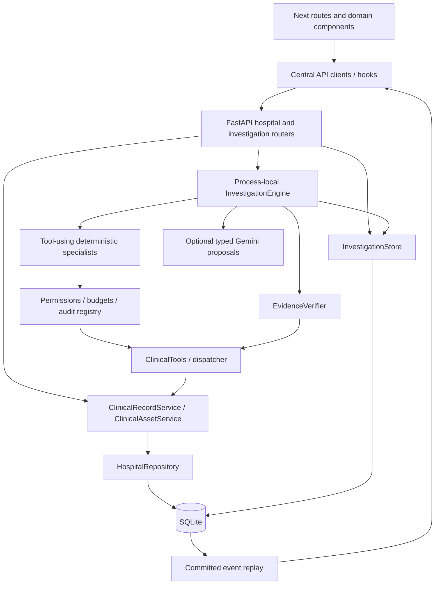

# Refactor 01 — Current-state architecture audit

Audit date: 2026-10-21. Baseline: `d7bbb1a8bfbd1182624f28970cd24c628401d715`.
Working branch: `refator/casetrace-mvp`; `develop/casetrace-mvp` and the merge base
both resolve to that same commit. The initial working tree was clean. Retain the
existing dedicated branch; its spelling is recorded verbatim. No commit or push
was made. This milestone changes documentation only.

Companion documents: [gap matrix](02-specification-gap-matrix.md),
[target architecture](03-target-architecture.md),
[compatibility and authority decisions](04-contract-compatibility.md), and
[sequenced backlog](05-refactoring-backlog.md).

## Assessment

CASETRACE has a working vertical slice, rather than five complete implementations
of the original broad product specification. A real hospital import feeds scoped
tools, deterministic specialists, independently resolved source verification,
durable findings/reports, REST/SSE, and a browser investigation workspace. Keep
these foundations. Incremental boundary extraction is practical; a rewrite is
unjustified.

The largest deficits are a concrete hospital dependency beneath tools, orchestration
and persistence responsibilities concentrated in two modules, a limited tool
contract behind twenty registered names, fixed analytical execution, incomplete
clinical hypothesis testing, and a hospital UI that displays records primarily as
generic cards. Exact benchmark discovery, live-provider quality, and operating-system
evaluator isolation remain separate acceptance gates.

## Review inputs and authority

Reviewed requirements and implementation references include `AGENTS.md`, `README.md`,
PRD, implementation plan, frontend/backend architecture and API contracts, database
and case schemas, tool/multi-agent specifications, state machine, evidence contract,
evaluation plan, development stack, local development, contract decisions, implementation
inventory, Phase 1–5 development/reports, Phase 3 decisions, CASE-001 dataset/report,
and the demo runbook. Historical reports are evidence of decisions and earlier
checks, not substituted for current test results.

The `.skill/` masters for case-trace-development, frontend-development,
backend-development, database-development, synthetic-case-generation,
hospital-system, investigation, evidence, casetrace-ui and demo were inspected.
There is **no installed `.skill/validation/SKILL.md`**. Validation guidance instead
exists in `.skill/case-trace-development/testing-strategy.md`, case-generation
guidance, project contracts, scripts and tests. Do not invent a missing skill.

The complete UI reference directory contains README, `ui-design.md`, `index.html`
and three screens. All four HTML pages were rendered in installed headless Edge
at 1440px and visually inspected. Screenshots are local ignored artifacts in
`data/runtime/refactor01-audit/prototype-*.png`. Their patient identities, sample
counts, dates and activity are illustrative; their layout and interaction ideas
remain useful. The production app was not rendered during this audit: probes of
ports 3000/3015 found no running app, and isolated frontend setup was rejected
by automatic approval review. Source-based visual comparisons below are identified
as such; this is not a pixel-diff or complete accessibility assessment.

## Actual architecture and module interactions

Paths below are relative to the repository root; function/class names identify
the inspected responsibility without depending on incidental line numbers.

| Module | Responsibility and important interaction | Assessment |
| --- | --- | --- |
| `apps/api/app/main.py:create_app` | Lifespan owns database, store, worker; recovery runs before serving; installs request IDs, errors and CORS | Coherent composition root; construct injectable adapters here in Refactor 02 |
| `core/config.py`, `core/database.py`, `models/types.py` | Root-relative absolute paths; one engine, bounded sessions, explicit BEGIN, per-connection FK/busy timeout, file WAL and UTC restoration | Retain; tests exercise path independence, rollback, savepoints and migrations |
| `api/routes/hospital.py` | Typed collection/detail routes, query models, dynamically registered resource routes, assets, summaries/series/search | Mostly thin; patient listing directly reaches `svc.repository` and filters in HTTP layer |
| `hospital/service.py` | DTO projection, patient resolution, filtering, ordering, summaries, series and timeline | Genuine service exists; it is a concrete ORM-aware class, not the interchangeable clinical interface specified in backend §13 |
| `hospital/repository.py` | Read-only queries over model classes and current document versions | Good source-write separation; returns ORM rows; full patient collections are materialized before service filtering/paging |
| `hospital/assets.py`, `asset_service.py` | Constrained case keys, registered MIME/size/hash checks; materializes asset descriptor and releases read transaction before filesystem work | Retain security/integrity behavior; formal storage capability interface is missing |
| `hospital/validation.py`, `ingestion.py`, `cli.py` | Maintenance-only clinical allowlist, links/assets preflight, deterministic UUID5 mapping, atomic import/no-op/conflict | Strong fixture boundary; JSON only; amendments intentionally fail closed |
| `tools/clinical.py:ClinicalTools`, `dispatch` | Concrete database/session/repository composition, DTO hashes and record resolution; twenty name/operation entries | Boundary exists but is tightly coupled to local storage and even imports `digest` from orchestration persistence |
| `tools/registry.py:ToolRegistry` | Checks persisted actor, allowlist, selected patient, count/size/deadline; writes start/result/error audit in separate operations | Real guardrails; catalog uses one generic input/output schema and generated descriptions |
| `agents/specialists.py` | Retrieval manifest; timeline notes/events; lab comparisons; medication source reads; targeted contradiction reads and correction search | Real tool execution; all specialists depend on concrete registry; no common typed run interface/context |
| `agents/analysis.py` | Pure time projection, regex onset pairing, first/last lab comparisons, medication field observations, referral status review and documentation alternatives | Useful deterministic core; narrow coverage; verifier imports this agent-owned analysis module |
| `orchestration/engine.py` | Schedules process-local tasks, serializes investigations, runs specialists and optional provider, verifies, builds report and finalizes | `_run` mixes workflow, collection, proposals, hypotheses, verification, timeline and report composition; fixed plan |
| `orchestration/store.py` | ORM queries, CAS/lock mutations/events, run creation, agent/tool/stage audit, evidence links, snapshots, reports and recovery | Real application persistence boundary; combines repositories, projections and lifecycle policy; no separate investigation repository |
| `evidence/verification.py` | Re-resolves every anchor; checks patient/version/hash/field/value/quote/encounter and registered assets; verifies three proposition rules | Strong fail-closed safeguards; unsupported semantics stay inconclusive; directly depends on concrete ClinicalTools and agent analysis |
| `llm/provider.py`, `llm/prompts/__init__.py` | LLMProvider protocol and Gemini REST adapter, bounded retries/context/output, Pydantic AgentResult | Provider abstraction exists. Rules mode is the absence of inference, not a LocalProvider. No OpenAI/Anthropic adapter is required just to populate a diagram |
| `models/hospital.py`, `models/investigation.py`, `alembic/versions/0001*`–`0004*` | Hospital tables, reports and observation junction; run/stage/agent/tool/event/evidence/finding/report storage | Hospital typed columns plus preserved payloads; investigation context/anchors/body are largely JSON; not the fully normalized catalog |
| `api/routes/investigations.py` | Creation/scheduling, snapshots, history, finding/detail, report and replayable stream | Typed JSON responses; 202 creation, 409 unavailable report; no list/cancel/resume route |
| `scripts/evaluate_system.py`, `evaluate_investigation.py`, `evaluation/` | Isolated application replay, frozen report, then offline answer-key scoring | Real independent anchor/proposition checks; exact scorer is still not semantic clinical assessment |

There is no `workers/` or `app/evaluation/` package. Execution lives in the engine
and evaluation in offline scripts. These are not missing runtime capabilities
merely because suggested folder names differ.

## Persistence, failure and provenance findings

1. **Keep transactions short.** `InvestigationStore.mutation` serializes writes,
   checks version/status with CAS, and commits an event with the mutation. Clinical
   reads open separate sessions; LLM calls, asset validation and SSE delivery do
   not retain those transactions. There is no generalized bounded database-lock
   retry service beyond SQLite busy timeout; add only with an actual contention test.
2. **Stage outcomes can overstate success.** `engine.py:run_agent` records agent
   failure and limitations, but `_run` subsequently calls `stage(..., True)` for
   timeline/specialists/contradiction. `store.py:stage` always marks completed and
   increments progress. A limited report is honest at run level, but stage-level
   completion is not a sufficiently precise outcome. Track under A-04; do not
   change lifecycle behavior during structural extraction.
3. **Durability is real; resumability is absent by decision.** Startup recovery
   marks interrupted queued/running work failed and closes in-flight audits.
   Retry is a new POST; process-local tasks and the single-process semaphore are
   not a durable queue. No distributed worker is warranted for the MVP.
4. **Finding attribution/lineage is incomplete.** Stored finding JSON has anchors,
   status and checks, but no creator agent/execution ID. EvidenceRef has anchor
   JSON and retrieval time, without an originating tool-call FK. Duplicate-anchor
   validation and finding logical keys do not reconstruct the full derivation chain.
5. **Report publication relies on engine discipline.** `store.finalize` atomically
   publishes report and terminal status but does not independently validate report
   findings against the persisted verified set, required stages or report/run ID.
   This is a service invariant to add later, not an observed public exploit.
6. **Logical isolation is demonstrated; local OS isolation is not.** Agents have
   no direct DB/file imports; maintenance drops evaluator/editor sections. A
   same-user process can still read repository answer keys. `.dockerignore` and
   Compose exclude cases/keys and mount assets read-only, but Docker runtime
   isolation has not been exercised here. Trusted local API detail routes are
   not production patient/actor authorization.

## Frontend and rendered-design comparison

The App Router build exposes `/`, `/patients`, `/patients/[patientId]`,
`/investigations/[investigationId]` and its `/report` child. Root layout applies
`components/layout/app-shell.tsx`; no patient or investigation nested layout exists.
Errors/loading/not-found routes exist. Feature components, centralized `lib/api`,
`lib/sse` and hooks are already separated; a missing `features/` folder alone is
not an architectural defect.

| Area | Actual implementation and observable design difference |
| --- | --- |
| Shell/dashboard | `app-shell.tsx` retains navy sidebar, topbar and synthetic label; only Overview and Patient records links. Overview is always visually selected. No collapsible sidebar, case library, investigation inventory, global search or demo profile. `app/page.tsx` shows health and searchable real patients; prototype summary cards, featured-case panel and recent-run feed are absent |
| Patient chart | `patient-record.tsx` has eleven live record sections and launch flow; defaults to encounters. Prototype combines a summary timeline, labs, medication and documents in two columns. The implemented chart lacks that summary, encounter drill-down and URL-preserved section selection |
| Clinical density | `record-card.tsx` is an explicit field allowlist rendered as two-column definition lists, not raw JSON. Laboratory and medication data exist, but no analyte trend chart/table or medication timeline. Source IDs in chart cards are mainly text rather than related-record links |
| Documents/imaging | `document-asset.tsx` fetches registered bytes, uses object/iframe and download with HTML download-only. `imaging-assets.tsx` lists previews. No integrated document list/context/metadata viewer, exact PDF locator, app-owned page/zoom controls or image pan/zoom. Native PDF controls are browser dependent; do not claim they never exist |
| Workspace | `workspace.tsx` has three areas at >=1280px: 185px context/agent rail, tabbed main content, evidence inspector. Prototype shows stage rail, richer agent tasks, tools/timeline and findings simultaneously. Mobile stacks panels; no collapsible drawers. Comparison is real and grouped by source, but sits above the workspace |
| Activity | `agent-activity.tsx` renders persisted history and source buttons; correlation uses repeated `events.find`, O(n²). Durations/safe query details are not exposed by the current event payload/inspector even though ToolCall stores duration |
| Timeline/evidence | Timeline preserves named time fields and offers category/date filtering and source opening. `Date.parse` sorting treats date-only values as instants for ordering despite precision labels; clinical chart timeline links are text. Evidence inspector highlights entire cited field, displays quote/hash/version and warns about changed fields; it cannot open archived versions or select a PDF passage |
| Report | `report.tsx` has verified/unresolved/rejected sections, timeline, hypotheses, limitations and provenance/print. Prototype has a compact summary with a separate evidence index. Actual report repeats complete finding cards and execution history; lacks consolidated source index and reviewed print pagination |
| Types and maintenance | `types/hospital.ts:ClinicalRecord` is an open index signature; parsing checks selected fields then casts. Investigation types/validators are richer. `workspace.tsx`, `report.tsx`, `record-card.tsx` are compact in physical lines but dense JSX; extract by responsibility when adding features, not by line-count quotas |
| Accessibility | Skip link, landmarks, labels, pressed states, focus/reduced-motion rules, error/status text exist. Comprehensive keyboard, contrast, focus restoration, screen-reader and print checks remain unverified; no evidence supports declaring the entire app inaccessible |

## Tools and agent behavior

All twenty distinct named tools in agent-tools §§11–20 exist in `TOOL_SPECS`.
The repeated `search_documents` section is one tool, not a missing twenty-first
registration. Their semantic/parameter gaps are itemized in the gap matrix.

Patient/agent scope, audit and budgets are implemented. Tool data still uses
`dict[str, Any]`; all names share ToolInput. `search_patient` is effectively a
selected-patient getter, `build_patient_timeline` lists clinical events, and
`compare_lab_results` returns two compatible raw records rather than the documented
calculated comparison. Searches retrieve a full document DTO/hash and then replace
`data` with the hit/snippet, so `source_hash` no longer hashes the returned `data`.
Original retrieval remains necessary before claiming document evidence.

Retrieval, timeline, laboratory, medication and contradiction specialists really
call tools. Lab and medication run concurrently. Deterministic analyses select
those calls. There is one optional model proposal request during contradiction
investigation; the model does not select or invoke tools. Synthesis is a
deterministic report builder inside the engine. There is no adaptive planning,
persisted task graph, per-agent memory, evidence-driven bounded re-investigation
loop or comprehensive diagnostic hypothesis challenger. Retain the controlled
topology while adding these capabilities deliberately.

## Clinical intelligence and dataset

`analysis.py:ONSET` requires English wording equivalent to “X [first] began on
Month D, YYYY; no X before then.” It does not cover relative dates, synonyms,
abbreviations, recurrence, attribution, hedging or multilingual text. `onset_pair`
uses simple symptom/negation matching and requires earlier occurrence **and**
documentation; this avoids some delay false positives but does not establish that
two mentions describe the same episode. Verifier and detector share this rule,
so independent source resolution is not independent semantic validation.

Laboratory analysis compares first and last compatible values; it is not a full
trajectory, reference-range or missing-measurement assessment. Medication output
verifies source fields, not exposure/symptom relationships. Follow-up checks only
referral status; it neither extracts recommendation deadlines nor joins completed
imaging before deciding that documentation needs reconciliation. `challenge`
creates a documentation alternative and assigns anchors by list position. The
engine validates hypothesis citations and forces inconclusive, but never verifies
whether a valid anchor semantically supports its “supports” or “weakens” label.
The UI displays those labels, so citation validity must remain distinct from
semantic support.

CASE-001 contains 7 encounters, 8 clinical events, 25 observations, 7 medications,
23 documents, 3 imaging studies/assets, 2 referrals, 3 diagnoses, 1 symptom and
8 diagnostic reports. The source instants retain +03:00, medication periods can be
dates, PDF text matches the canonical records, and images are illustrative PNGs.
Data/assets are already sufficient for much richer encounter, laboratory,
medication and document presentation. Missing case library/history endpoints and
typed linked viewers are API/UI deficits, not reasons to regenerate the fixture.
Only CASE-001 exists under `data/cases/`; nine further cases and held-out variation
are genuine data gaps. Expert clinical review remains pending.

The new isolated replay reproduced Phase 5's distinction: 1 verified record-level
contradiction, 13 verified findings, 108/108 valid citation anchors, 13/13
deterministically supported findings, 81/81 source timeline projections, 6/6
required source coverage, but strict discovery **0/1**, partial **1/1**. Context
snippets do not satisfy the exact gold anchor set; broad source coverage
across different findings is not a complete explanation. Inspect failed anchors
offline before changing discovery. The scorer itself pools anchors across
verified findings and requires only overlap with a chronology finding; a future
claim-local semantic evaluator is also needed. Never edit truth to improve score.

An offline comparison of the new frozen report identifies the exact failing
anchor: `DOC-001-01.text_content` expects the passage “Cough present for about ten
days”, but the emitted contextual anchor quotes only “cough”. All other expected
anchors satisfy the current scorer. `analysis.py:contradictions` uses the matched
symptom word as the contextual quote, which explains this failure without any
missing source record. The verified chronology itself compares `DOC-001-05` with
`EVT-001-01`; the medication/source chain is spread across other verified
observations. Later work must preserve a meaningful source passage and assess
the full claim-local relationship, rather than merely making a substring test pass.

## Baseline executed during this audit

Existing native Windows uv/pnpm environments were used; no clean install, external
service installation, live provider call, reset or canonical regeneration was run.

| Command/check | Actual result |
| --- | --- |
| `cd apps/api; uv run --locked ruff check .` | Passed |
| `uv run --locked ruff format --check .` | Passed; 58 files already formatted |
| `uv run --locked mypy` | Passed; 48 application files |
| `uv run --locked --group case-data pytest -q` | **65 passed, 1 skipped**, 190.80s; Windows symlink privilege skip and Starlette/httpx deprecation warning |
| Migration integration in `test_foundation.py:test_alembic_upgrade_downgrade_and_cwd` | Passed as part of pytest: upgrade/current/downgrade/re-upgrade/check on temporary storage |
| `uv run --locked alembic upgrade head` then `alembic check` | Passed on explicit `data/runtime/refactor01-audit/browser.db`; no new upgrade operations |
| `uv run --locked --group case-data python ../../scripts/validate_case001.py` | Valid; 26 assets, all 23 PDF pages rendered |
| `uv run --locked python -m app.hospital.cli validate CASE-001` | Valid; 26 assets |
| `uv run --locked python -m app.hospital.cli import CASE-001` | Passed on separate audit DB only |
| `uv run --locked python ../../scripts/evaluate_system.py --output ../../data/runtime/refactor01-evaluation --repeats 1` | Completed, rules mode, 52 tool calls, 0 failed events, 11.794s API-to-report; partial benchmark as above |
| `cd apps/web; pnpm.cmd typecheck` | Passed |
| `pnpm.cmd lint` | Passed |
| `pnpm.cmd test` | **33 passed**, 4 files |
| `pnpm.cmd build` | Passed, optimized Next.js 16.4.2 build and route inventory |
| Existing API smoke/investigation integration | Executed in pytest plus evaluation runner; no separate shell smoke command claimed |
| Four reference HTML pages in Edge | Rendered and visually inspected |
| Browser E2E | **Not executed.** No app running on probed ports; automatic approval review rejected isolated frontend build/start command with “blocked by policy”; no more specific reason was supplied |
| Live inference, Docker, comprehensive accessibility/print, held-out clinical evaluation | Not executed; separate future gates |
| Local Markdown targets / `git diff --check` | Passed; no broken local links in 11 changed/new Markdown files and no whitespace errors |

The short-lived audit API used port 8019, rules mode, explicit CORS and the audit
database; it was stopped after frontend setup failed. Existing development DB and
canonical/evaluator files were not targeted by maintenance commands. Local replay
exports/screenshots and audit DB are ignored, not new committed fixtures.

## Refactor 02 readiness

Proceed with structural boundary extraction on this baseline: inject typed hospital
and source-resolution capabilities, move persistence-specific composition out of
ClinicalTools, separate investigation service/query/persistence responsibilities,
and untangle verification rules from agent-owned analysis. Preserve runtime
schemas, route names, IDs, event order/cursors, recovery policy and deterministic
results. Stage semantics, missing tools, intelligence and UI work remain later
behavior changes with their own contracts and tests. See backlog R02 for the
concrete acceptance gate.

## Documentation changes

Created the five documents in `docs/refactoring/`. Added audit/authority links to
README and frontend/backend architecture; clarified the historical domain gate in
AGENTS; corrected evidence-contract's unsupported review rule and obsolete Phase 3
gate; fixed the UI reference path in `.skill/case-trace-development/SKILL.md`.
No runtime checks or dependencies were added. The protected-path diff check for
`apps/api`, `apps/web`, `data/cases`, `data/assets` and `evaluation` passed after
the documentation edits.
