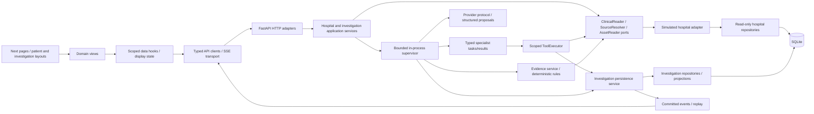

# Refactor 01 — Target architecture

This is the proposed engineering blueprint, not a statement that the target is
implemented or approval for breaking contract changes. The
[compatibility decisions](04-contract-compatibility.md) constrain every milestone;
the [gap matrix](02-specification-gap-matrix.md) supplies evidence and the
[backlog](05-refactoring-backlog.md) defines acceptance gates.

## Retained system shape

Keep Next.js App Router/TypeScript/pnpm/Tailwind/shadcn and one FastAPI
Python 3.12+/uv process with asyncio, SQLite/aiosqlite/SQLAlchemy and Alembic.
No Redis, queue platform, graph database, FHIR integration or database service is
needed. Local development remains preferred. An optional API/web deployment has
writable persistent runtime storage and read-only registered assets.

## Hospital, tool and asset boundaries

The hospital adapter provides clinical DTOs, resource identity, original time
semantics, version and source fingerprint without exposing ORM rows, sessions or
maintenance inputs. Define narrow Python Protocol capabilities for the methods
actually consumed: selected patient, paged resource queries, document search,
original source resolution, study/report/asset metadata and registered bytes.
Do not create a generic integration framework or empty adapters.

The existing concrete ClinicalRecordService and ClinicalAssetService remain the
local implementations. A composition factory/lifespan creates repositories and
sessions; tools receive capabilities, not `Database`, `HospitalRepository`, model
classes or filesystem roots. Direct HTTP detail reads retain the trusted local
contract; investigator source resolution always validates selected patient.
Future actor authorization belongs in the application service, never just in a
browser check.

SourceResolver returns canonical SourceRecord with stable `source`, source_version,
source_hash and DTO data. Move canonical JSON digest/time helpers into a small
neutral shared module with byte-for-byte tests. Keep distinct fingerprints for
canonical source DTO, document text, asset bytes and dataset content. A search
hit references a source fingerprint; it must not misleadingly claim that its
snippet projection hashes to the same value.

AssetReader separates metadata resolution from potentially blocking byte/hash
work. LocalAssetStorage already supplies valuable constrained-key behavior;
wrap/inject it rather than replacing it. HTTP clients never supply storage keys.
Close read transactions before hashing/streaming. Keep MIME allowlists, synthetic
labels, hash/size verification and HTML download-only behavior.

## Tool system

Each real tool definition owns a name, purpose, validated input, output,
permission, handler and safe audit projection. Retain existing names with explicit
adapters from generic `record_id/other_id` inputs. Improve semantic behavior in
R04, after structural extraction. Do not silently change a clinical-event list
into an all-resource timeline under a legacy name.

ToolExecutor enforces persisted run/actor identity, selected patient, role scope,
query/paging bounds, result size, deadline and shared budgets before dispatch.
It persists start, executes session-free work, then persists result/error. Audit
only safe validated filters and identities, source references and duration;
exclude complete notes, secrets and raw model reasoning. A typed tool exception
should preserve deterministic failure categories without leaking clinical content.

Specialists receive only the executor/catalog and a bounded task context. They
must not receive the executor's store, concrete clinical adapter or unrestricted
filesystem/network capability. Tests inject a fake executor for unit behavior
and a real local adapter for contract/integration tests.

## Investigation application and persistence boundaries

Investigation application service owns create/idempotency, legal transitions,
worker scheduling, authoritative query operations and report publication. Keep
router HTTP validation/serialization and stream framing separate. The service
uses a persistence collaborator for ORM work and a query projector for DTOs.
These may remain in a small number of files until complexity warrants a split;
folder names are subordinate to visible ownership.

The persistence service remains the single serialized mutation boundary in one
process. Preserve short explicit transactions, independent AsyncSessions,
version/status CAS, unique event sequence and logical finding keys. Commit state,
dependent rows and durable event atomically. Stream only committed rows and drain
the terminal tail. Do not retain transactions across LLM/tool/asset/SSE waits.

R02 keeps current JSON payload storage and applied revisions. Later lineage work
adds explicit creator/agent/tool relations only after schema review and a new
migration. Evidence anchors retain original source versions and values. A future
amendment workflow appends versions; never mutate a record to repair a finding.
Do not normalize every JSON field merely to resemble the catalog.

Report publication must eventually validate run identity, legal final state,
required stage outcomes, persisted findings and citation-verification state at
the application boundary before committing report+terminal state. The engine
must not be the only place that knows these invariants. An outcome can be
completed with limitations even when no contradiction is found; clinical
uncertainty is distinct from execution failure.

## Agents, orchestration and clinical reasoning

Retain retrieval → timeline → parallel labs/medication → contradiction →
verification → synthesis as the controlled MVP topology. Introduce typed task,
source-manifest and specialist result contracts with execution attribution.
Deterministic specialist execution is an explicit mode. Provider-assisted
proposals and adaptive planning are separate capabilities and must be labeled.

In R05, bounded evidence requests can branch to an allowed tool and re-evaluation
task. Persist concise task inputs, dependencies, outputs, attempts and terminal
reason; never private reasoning. Enforce maximum iterations, calls, elapsed time,
context and output tokens. Optional evidence exhaustion produces unresolved
findings, not an infinite search. Persist failed/skipped stages truthfully.
Until an approved recovery change, interrupted runs fail on startup and a new
POST starts a new run; no hidden resume is introduced.

Planning/selection belongs to orchestration and specialists; clinical record
retrieval belongs to tools/hospital. Analysis functions are pure and source-led.
Move shared chronology/proposition functions out of `agents/analysis.py` only
where verification and investigation both need them. Do not duplicate slightly
different timestamp rules in the detector and verifier. Add independent semantic
and negative controls because shared code alone cannot demonstrate clinical
correctness.

Verification separates three questions:

1. Does the cited source/version/field/quote/value exist in scope?
2. Does a deterministic proposition follow from those exact source values and
   temporal precision?
3. Does an interpretation or hypothesis have semantic support, counterevidence,
   same-episode context and remaining uncertainty?

Only supported deterministic propositions become verified automatically. Source
existence cannot establish a diagnostic explanation, medication causality or
whether follow-up occurred. Structured model extraction may propose source-backed
assertions; deterministic code validates original values and temporal comparisons.
Unsupported language remains explicitly inconclusive. Hypothesis relationship
labels require assessment rather than anchor-list position.

## Frontend target

Keep domain components and centralized clients/hooks. Thin App Router pages select
patient/investigation identity; contextual layouts compose shell/navigation. Do
not move every component into a new `features/` tree. Keep original deep links and
single-source `source/source_type` query state.

Introduce typed resource DTOs/parsers before specialized views. A hospital feature
owns its patient/encounter context, precise lab table/series, medication history,
document metadata/text/PDF and study/gallery views. Shared presentation owns
status, loading/error/empty, source links and time formatting. Reuse existing
RecordCard and asset transport during gradual conversion.

REST hooks own snapshots; SSE transport owns framing/replay and sequence-aware
event merging. Display state owns tabs, comparison and zoom. Keep data scoped by
patient/run and abort on identity change. Repair partial-date ordering explicitly;
displaying a date label does not justify treating it as a known midnight instant.

The desktop workspace has workflow/context, active work plus timeline/findings,
and evidence detail with collapsible secondary panels. The patient chart gets a
real summary and linked encounter context. The report gets a source index and
readable evidence sections. Apply the existing navy/blue/teal tokens, compact
clinical typography, structured tables and status text; do not reproduce prototype
fictional activity/counts. Verify desktop 1440/1024, tablet and mobile, keyboard,
focus, screen-reader statuses, reduced motion and multi-page print.

Case and investigation libraries remain product requirements. Their read-only
metadata/list contracts must be defined additively before rendering. Case
metadata must be neutral and must not reveal intended mystery/evaluator labels.
No fabricated cards for CASE-002–010.

## Storage and offline evaluation

Clinical fixtures remain in `data/cases/`; registered PDFs/images in
`data/assets/`; runtime state in `data/runtime/casetrace.db` (ignored, with WAL/SHM).
Maintenance validation/import runs before serving, using the same configuration
and connection factory. Asset generation stays outside runtime transactions.
Amendments and additional cases are independent, versioned work.

Offline evaluator runs on frozen report/event exports after investigation
finalization. It can access the answer key; runtime cannot. Enforce that boundary
with a separate OS principal/container and mount test before claiming sandboxed
isolation. Existing local logical isolation remains valuable but insufficient for
that claim. Keep exact-anchor coverage, semantic support, clinical assessment,
false positives, uncertainty and runtime reliability as separate metrics. A
partial benchmark must remain partial until engineering resolves the real gap.

## Existing-module disposition

| Existing module/group | Disposition | Reason and migration boundary |
| --- | --- | --- |
| Settings/database/UTC types/migrations | Retained | Already tested; preserve paths, WAL, FK, timeout and old revisions |
| Hospital service/repository | Retained and refactored | Add injectable DTO-facing port; move patient list policy from router; no FHIR adapter |
| LocalAssetStorage/ClinicalAssetService | Retained and adapted | Extract capability protocol; preserve storage keys and hash semantics |
| ClinicalTools/dispatch | Split responsibilities | Separate local hospital composition from tool definitions/handlers; compatibility wrapper for existing calls |
| ToolRegistry | Retained and refactored | Keep all guardrails/audit, expose narrow executor interface and specific tool contracts |
| InvestigationStore | Split incrementally | Separate repository/query projection from mutation/lifecycle application service; preserve one transactional writer boundary |
| InvestigationEngine | Refactored | Extract report assembly/result aggregation and injectable collaborators first; bounded planning later |
| specialists.py | Retained | Narrow executor and typed results; split by specialist only when needed for independent maintenance |
| analysis.py | Split selectively | Shared chronology/rules move to neutral domain/evidence location; agent-only planning stays agent-owned |
| EvidenceVerifier | Retained and refactored | Depend on source port/pure rules; source/proposition/semantic results remain distinct |
| Provider/prompts | Retained | Protocol/typed output reusable; add role prompts as real capabilities require |
| Frontend domain components/API/SSE/hooks | Retained and incrementally split | No feature-tree rewrite; typed hospital records and context-specific views added gradually |
| Generic RecordCard | Retained as fallback, gradually specialized | Existing empty/error/field behavior must keep working while clinical tables/viewers appear |
| Evaluation/reset/validation scripts | Retained outside runtime | Do not move evaluator into agent-importable package |
| Historical route/DTO/state examples | Deprecated as executable guidance | Cross-reference authority, preserve design intent/history |

No working public endpoint or clinical fixture is deprecated by this blueprint.
