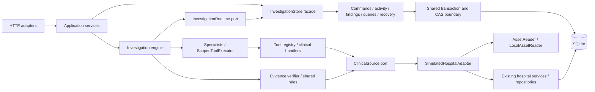

# Refactor 02 — Backend architecture and code structure

Date: 2026-10-21. Starting commit: `a3dcdad0f65868eabf16fe36ab4685053c70a0d8`.
The initial tree was clean on `refator/casetrace-mvp`; work remains on that
existing branch. The requested integration destination is `develop/casetrace-mvp`.
No branch reset, commit, push, clinical-data edit or migration was performed.

## A. Implemented scope

The functional backend was retained. Refactor 02 replaces the tool layer's local
database construction with an injectable clinical source, separates persistence
responsibilities behind one transaction boundary, extracts shared pure evidence
rules, and moves HTTP use-case logic into services. It adds no product features,
clinical reasoning, advanced tool semantics, dependencies or public schemas.

## B. Before and after

| Before | After |
| --- | --- |
| ClinicalTools constructs sessions, repositories and asset services | ClinicalTools consumes ClinicalSource; SimulatedHospitalAdapter owns local retrieval |
| Engine constructs clinical storage and Gemini provider | Composition builds adapters/provider; engine requires clinical and persistence ports |
| Specialists receive the registry with store/source members | Specialists receive ScopedToolExecutor exposing patient identity and execution only |
| Verifier imports agent analysis and concrete ClinicalTools | Verifier consumes SourceResolver, shared clinical rules and exact anchor validation |
| Store contains transaction management, all writes and read projections | Shared InvestigationPersistence plus commands, activity, findings, queries and recovery collaborators |
| Router filters patient ORM rows | ClinicalRecordService owns patient filtering and DTO projection |
| Investigation POST performs create/schedule/read logic | InvestigationService owns the use case; router serializes its result |
| Engine embeds report construction | reporting.build_report consumes persisted findings and timeline/hypotheses |

## C. Interfaces and concrete implementations

- `clinical/ports.py`: ClinicalReader provides patient-scoped, paginated records
  and document search; SourceResolver resolves one original SourceRecord;
  ClinicalSource combines these capabilities. Existing SourceType/SourceRef/DTOs
  cover patients, encounters, notes/documents, observations, medications,
  diagnostic reports, imaging, referrals, diagnoses and symptoms. No competing
  resource schema was created.
- `hospital/adapter.py`: SimulatedHospitalAdapter implements those capabilities
  using the existing services and read-only repository. It retains patient/record
  ownership checks, original timestamp values, versions, hashes and missing-source
  errors. Imaging asset metadata retains its existing study version semantics.
- `clinical/assets.py`: AssetReader verifies a registered descriptor;
  LocalAssetReader retains constrained local paths, MIME/size/hash checks and
  existing asset errors. AssetDescriptor was moved out of the ORM-aware service.
- `tools/ports.py`: ToolExecutor describes the specialist capability;
  ScopedToolExecutor wraps the registry's execute callable. This is capability
  separation, not an in-process security sandbox.
- `orchestration/ports.py`: InvestigationRuntime describes workflow persistence;
  ToolAudit is the smaller registry-facing audit contract. Neither exposes DB,
  sessions or models. InvestigationStore implements the runtime contract.
- `services/investigations.py`: Scheduler describes scheduling for the creation
  use case; the existing engine supplies it.

The test-only FixtureHospital substitutes for local storage and runs actual
clinical handlers, MedicationAgent and EvidenceVerifier without SQLite. A
separate contract test compares its medication DTOs with the local adapter.

## D. Dependency composition and lifecycle

`composition.build_engine` constructs the configured provider and local adapter
for API, CLI and test callers. `create_app(settings, clinical=..., assets=...,
provider=...)` permits direct substitution without patching implementation
modules. Lifespan initializes the database, composes the store and worker,
recovers interrupted runs, then serves. Shutdown cancels and awaits workers
before disposing the database, including on failure.

Hospital request-scoped services are constructed in `api/dependencies.py` and
can be overridden through FastAPI dependencies. Local asset verification uses
the lifespan-managed reader. Each hospital operation materializes DTOs within
its own session; asset IO happens after session release. No session or ORM row
is given to specialists or retained during provider calls or SSE waits.

## E. Persistence ownership

| Module | Responsibility |
| --- | --- |
| `orchestration/persistence.py` | One lock, session/transaction scope, run lookup, version/status CAS and atomic ordered event insertion |
| `orchestration/commands.py` | Idempotent creation, lifecycle changes, context and atomic report/terminal-state publication |
| `orchestration/activity.py` | Stage, agent, tool and generic durable event writes |
| `orchestration/findings.py` | Logical finding deduplication, verification JSON, valid evidence registration and source links |
| `orchestration/queries.py` | Snapshots, ordered event replay, findings and report projections |
| `orchestration/recovery.py` | Startup interrupted-run failure and in-flight audit reconciliation |
| `orchestration/store.py` | Supported application facade delegating to those collaborators |
| `orchestration/state.py` | Existing transition table, terminal states and conflict error |

All collaborators share the same InvestigationPersistence instance. Extraction
does not create separate writer locks or split a state/event transaction.
Queries use independent short sessions. Creation retains local patient/dataset
foreign-key resolution in the persistence implementation; a future remote
hospital integration still needs an approved local identity-registration policy.
This milestone does not claim a working remote adapter.

The facade is retained because API, worker, CLI and existing tests use it.
RunConflict/TERMINAL remain available at their supported store import location.
The service's HospitalError and agent analysis helper imports remain available
for current callers; runtime consumers use the neutral modules directly.

## F. Evidence boundaries

`core/provenance.py` holds the unchanged compact, sorted, UTF-8 JSON digest and
UTC clock helper. Canonical DTO digests remain distinct from document text,
asset-byte and dataset fingerprints. `clinical/rules.py` owns the existing pure
instant, anchor and explicit-onset proposition functions shared by detector and
verifier. `evidence/provenance.py:anchor_matches` owns exact version/hash,
encounter, field/value and quote-membership checks.

No parser or verification rule was broadened. Unsupported propositions still
remain inconclusive. The existing search-hit projection/fingerprint mismatch
is deliberately unchanged and remains R04 work: snippets require original-source
retrieval before use as exact evidence. Existing clinical/semantic limitations
remain visible rather than being reclassified as architectural improvements.

## G. Contract compatibility and organization decisions

The generated OpenAPI document is identical to the captured starting document,
including operation IDs, paths, request/response schemas and status definitions.
The hospital namespace remains `/api/hospital/v1`; investigations remain
`/api/investigations`. Pagination, error envelopes, source IDs, anchors,
permissions, audit events, budgets, lifecycle values, replay and report JSON are
unchanged. There are no externally observable intended changes.

Dynamic resource routers and existing grouped ORM/schema modules were retained:
they are cohesive registries/contracts and splitting them adds no boundary value.
Routes no longer construct repositories or inspect patient ORM fields. Physical
tables, mappings, indexes, constraints and applied revisions remain unchanged.
CASE-001 clinical JSON, PDFs/images, manifests and answer keys are untouched.

## H. Executed validation

Starting checks: `uv run --project apps/api pytest apps/api/tests -q` reported
**65 passed, 1 skipped**. From `apps/api`, `uv run ruff check .`,
`uv run ruff format --check .` and `uv run mypy` all passed.
An isolated starting replay and OpenAPI snapshot were saved before edits.

Post-refactor commands and results:

| Command / check | Result |
| --- | --- |
| `uv run ruff check .` (apps/api) | Pass |
| `uv run ruff format --check .` (apps/api) | Pass, 79 files |
| `uv run mypy` (apps/api) | Pass, 68 application files |
| `uv run pytest tests/test_investigation.py tests/test_phase5.py -q` after initial extraction | 21 passed |
| `uv run pytest tests/test_architecture.py -q` | 7 passed |
| Full `uv run pytest -q` | 72 passed, 1 skipped, 108.14 seconds |
| `uv run python -m app.hospital.cli validate CASE-001` | Valid, 26 assets |
| OpenAPI before/after comparison | Exactly equal |
| `pnpm.cmd typecheck`, `pnpm.cmd lint`, `pnpm.cmd test`, `pnpm.cmd build` (apps/web) | Pass; 33 frontend tests |
| `pnpm.cmd exec playwright test --workers=1` | 3 passed, 21.2 seconds |

The full backend suite includes Alembic upgrade/current/downgrade/upgrade/check
on an isolated file database, hospital APIs/assets, evidence adversarial tests,
investigation lifecycle, duplicate execution, recovery and terminal SSE replay.
New tests cover adapter substitution, canonical digest compatibility, import
direction, concurrent idempotency, forced stale-version rejection, atomic
dependent-row rollback, session-free asset IO and worker cancellation/cleanup.

Browser tests used installed Edge, real API/web processes, an isolated migrated
database and copied clinical assets under `data/runtime/refactor02-browser`.
All three journeys executed: connectivity/retry and mobile width; control-case
chart/assets; CASE-001 investigation, evidence comparison, refresh, report source
navigation, mobile width and print export. This replaces the historical R01
browser limitation for these journeys only; it is not a comprehensive accessibility
or clinical review.

Environment corrections: PowerShell selected a blocked `pnpm.ps1`, so commands
used the installed `pnpm.cmd` executable without changing execution policy. The
first browser attempt had no build-time NEXT_PUBLIC_API_URL and failed connectivity;
it was stopped, rebuilt with `NEXT_PUBLIC_API_URL=http://localhost:8000`, then all
three tests passed. No source change was needed. PowerShell also represented a
replay's stderr deprecation warning as NativeCommandError despite completed
artifacts; the final replay captures process output directly and records exit code.
The existing Starlette/httpx deprecation warning and one platform-dependent skip
remain; no dependency upgrades were introduced. The skip is the symlink-escape
test because Windows requires Developer Mode or symlink privileges; the remaining
asset path/integrity checks execute normally.

Final replay process exit code: **0**. The seven new architectural tests are
included in the final full-suite total, not added arithmetically to an older run.

## I. CASE-001 regression

Frozen outputs are ignored local artifacts: `data/runtime/refactor02-before/`,
`refactor02-after/`, and `refactor02-final/`. Each evaluation uses its own temporary
SQLite database. Existing results were not overwritten. Runtime investigation
finishes and freezes reports before the offline answer-key evaluator is imported.

| Metric | Starting | Refactored |
| --- | --- | --- |
| Terminal state | completed | completed |
| Verified findings | 13 | 13 |
| Verified chronology discrepancies | 1 | 1 |
| Valid anchors | 108/108 | 108/108 |
| Independently supported findings | 13/13 | 13/13 |
| Accurate timeline sources | 81/81 | 81/81 |
| Strict discovery | 0/1 | 0/1 |
| Partial discovery | 1/1 | 1/1 |
| Tool calls / failed events | 52 / 0 | 52 / 0 |

Logical report content is exactly equal after removing only generated report/run/
finding IDs and creation/verification/generation timestamps and sorting findings.
Clinical timestamps and anchor content are included in the equality comparison.
Event sequences are contiguous; type counts match (52 starts/completions,
13 finding verifications, six agent starts/completions, five stage pairs).
No benchmark improvement or live inference is claimed.

## J. File inventory

New: `app/clinical/{__init__,ports,assets,rules}.py`, `app/composition.py`,
`app/core/provenance.py`, `app/evidence/provenance.py`,
`app/hospital/{adapter,errors}.py`,
`app/orchestration/{activity,commands,findings,persistence,ports,queries,recovery,reporting,state}.py`,
`app/services/investigations.py`, `app/tools/ports.py`, and
`tests/test_architecture.py` under `apps/api`; this report.

Modified: agent analysis/specialists, API dependencies and hospital/investigation
routers, central errors, evidence verifier, hospital service/asset service, main,
engine/store, clinical handlers/registry, investigation/Phase 5 tests,
`scripts/{evaluate_system,run_investigation}.py`, target/compatibility/backlog docs,
backend architecture, implementation plan and relevant skill guidance.
No files were deleted. Shared functions and report assembly were extracted into
new modules; canonical model/schema files were deliberately retained.

Final Git summary: **27 modified files, 22 new files, zero deleted files**.
`git diff --check` passes. No files under frontend, canonical data, evaluation or
Alembic revisions changed. Temporary browser API/web processes were stopped after
validation; their isolated databases, copied assets and test exports remain ignored.

## K. Remaining issues

Strict discovery remains partial. Advanced tool semantics, search projection
fingerprints, adaptive reasoning, creator/tool evidence lineage, richer stage
outcomes and independently enforced report publication invariants remain the
separate R04–R06 work identified by R01. Persistence is still intentionally
single-process SQLite. Local same-user filesystem access is not a sandbox.
Live-provider quality, held-out generalization and expert clinical/semantic review
remain unvalidated. Browser checks cover the existing journeys, not every fault,
screen-reader or visual-design requirement. No new global architecture is claimed
merely from splitting files.

## L. Refactor 03 readiness

The injectable clinical source and unchanged import/schema contracts provide the
R02 prerequisite for Clinical Case Data & Ingestion Modernization. Before adding
amendments, decide append-only versioning, historical citation resolution and
public identity registration, then review a new migration if needed. Preserve the
frozen CASE-001 manifest, same-version conflict rejection, deterministic no-op
reimport and runtime/evaluator separation. Add neutral readiness metadata only
from actual records. New clinical cases require separately authorized generation
and expert review; no placeholder cases or automatic regeneration are prerequisites.
